# Reshoot 4D

**Reshoot any video in 4D.**

- **Runs locally on open weights.** No API keys, no cloud services, no partner nodes.
- **Every step is a ComfyUI node.** The 4D camera editor is the Virtual Camera node's own panel.
- **LTX 2.3 renders every final frame.**

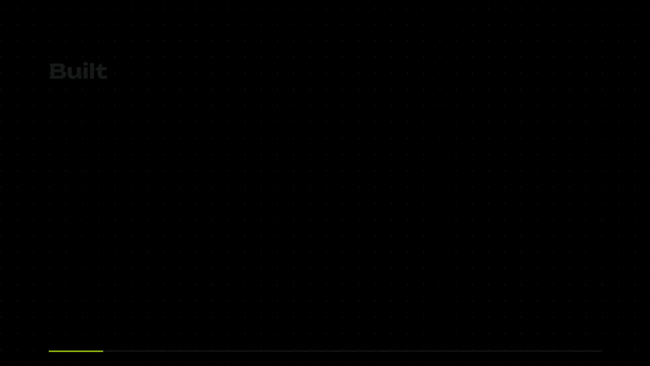

Watch the [explainer](site/media/explainer.mp4) (35 s) and the [walkthrough](site/media/walkthrough.mp4) (71 s).

## Node pack

| Node | What it does |
| --- | --- |
| **Capture** | Turns a video of a person into a 4D capture: their motion in 3D over time, the background scene around them, and an estimate of where the original camera stood and how it moved. |
| **Virtual Camera** | Opens the 4D camera editor on the node. Set camera keyframes (position, aim and lens at chosen moments) over the moving capture; the editor moves smoothly between them and the path saves with the workflow. |
| **Retake** | Re-renders the whole source video from your new camera path (ReDirector). Its output, the retake, is the draft the Photoreal Pass finishes. |
| **Photoreal Pass** | LTX 2.3 renders the final frames from the retake, guided by the real video and a depth warp of it along your path (CrossView-Warp IC-LoRA). |
| **Camera FX** | Applies the keys' lens and camera settings to the finished frames: zoom, focus and aperture (depth of field), vignette and grain. Changing them needs no new render. |
| **Finish** | Optional: a standard frame rate (24 to 60 fps, RIFE in-betweens), motion blur from a shutter angle, a resize to 1080p, 1440p or 4K, and the source audio. |

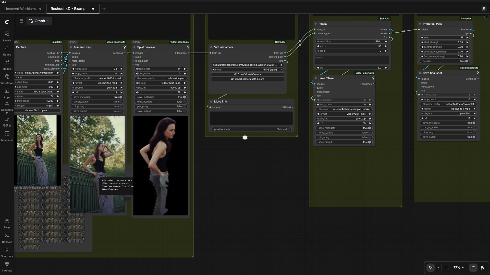

Load [the Reshoot 4D workflow](workflows/Reshoot%204D.json) and follow the [Workflow guide](docs/WORKFLOW.md).

## Terms

- **4D capture.** The person's 3D shape over time (3D plus time), the background scene and the estimated original camera. The editor shows it as a coloured mannequin (quick mode) or a 4D Gaussian splat (4DGS mode: the person as many soft coloured points, trained from generated views).
- **Source camera.** The camera that filmed your video, estimated from the footage: where it stood, where it pointed and its field of view. Distances are approximate and assume a 1.7 m tall person.
- **Keyframe (key).** The camera's position, aim, lens and settings at one moment. The editor moves the camera smoothly between keys.
- **Shot time and capture time.** Shot time is the position in your new camera move. Capture time is the moment of the original performance shown at that point.
- **Retake.** The first re-render of your video from the new camera. The Photoreal Pass turns it into the final frames.
- **Aperture (f-stop) and rack focus.** A lower f-stop gives shallower focus. A rack focus moves the sharp distance during the shot, for example from the background to the person.
- **Dolly zoom.** The camera moves back while the lens zooms in (or the reverse): the person stays the same size while the background grows or shrinks.
- **Shutter angle.** How much of each frame's time the shutter is open, which sets motion blur: 180° is half the frame time (the film look), 0 is none.
- **Lens character.** Distortion (barrel bulge), chromatic aberration (colour fringes towards the edges), bloom (a glow around highlights), halation (a warm red glow around bright edges, as on film) and anamorphic bokeh (oval out-of-focus highlights).
- **Depth and matte passes.** An image of each pixel's distance and a mask of the person, for compositing.
- **RIFE.** An open model that generates in-between frames, used for higher frame rates and motion blur.

## Results

### New in 0.1.0

**Camera settings on every key.** Set the aperture after the render: the same frames with no depth of field, then shallow.

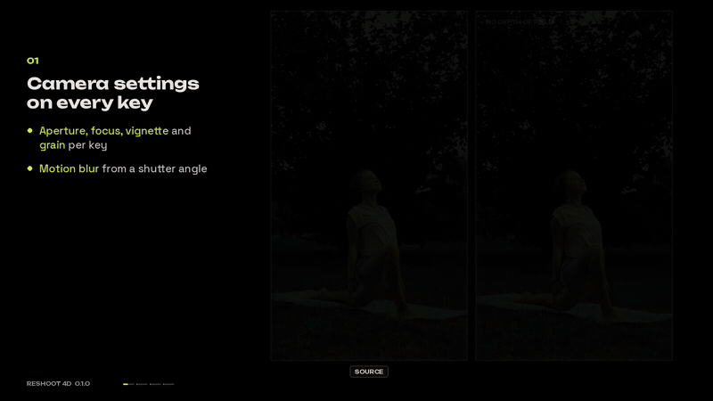

**Bring your own camera.** A crane move made in Blender, imported as an `.fbx` camera and started on the source camera.

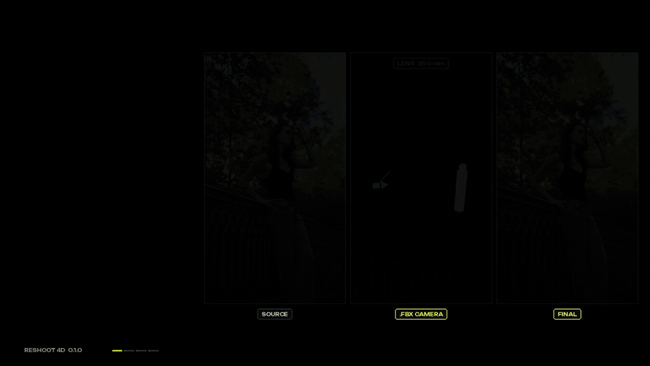

**Zoom through the lens.** A dolly zoom: the camera pulls back while the lens zooms in, so he holds his size while the skyline grows.

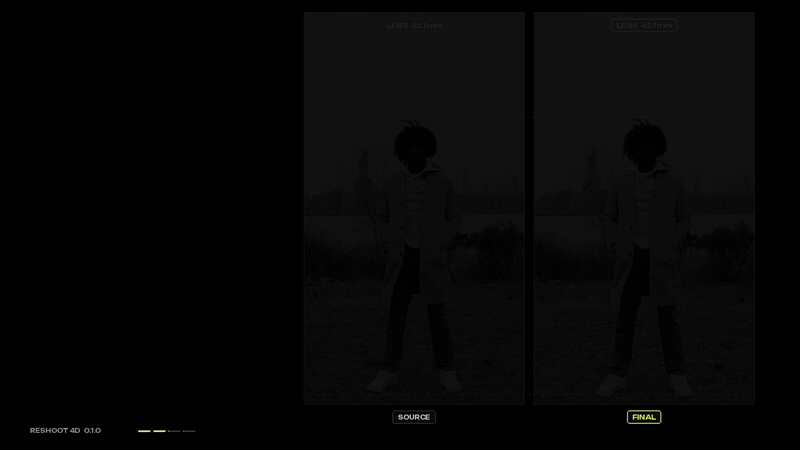

### Reshoots

Each example: the source video, then three new camera moves. The top view on each reshoot shows the camera path.

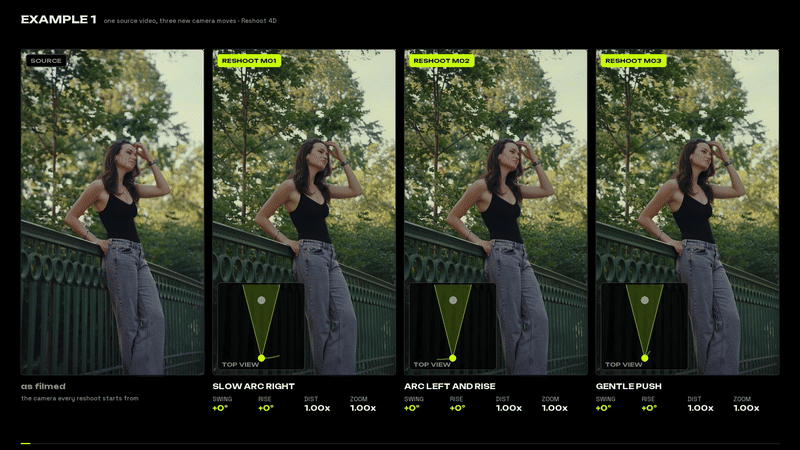

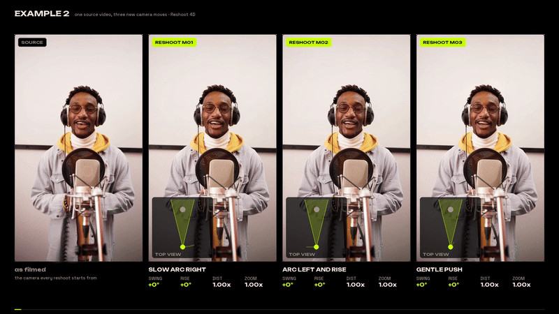

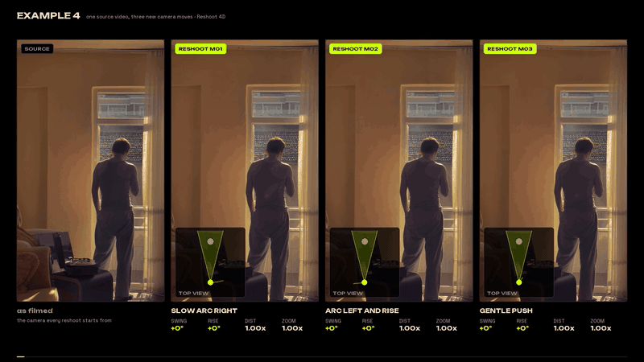

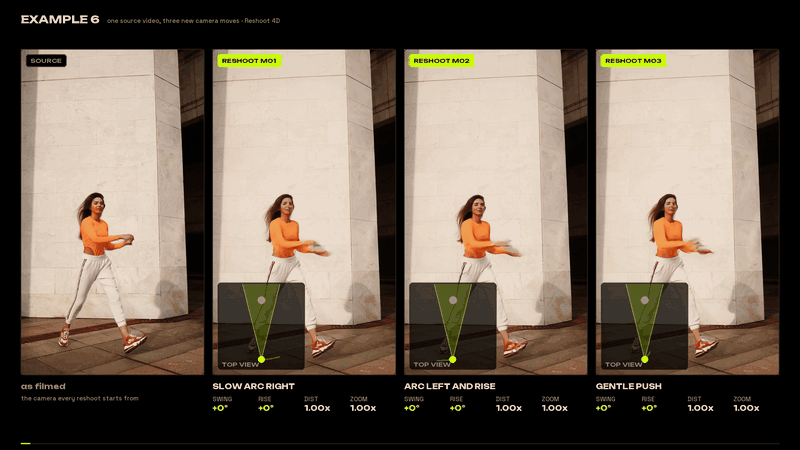

Footage from Pexels, see [Credits](docs/CREDITS.md).

## Limitations

**No fixed world.** Reshoot 4D does not build a 3D world and composite the person onto it. Each reshoot regenerates what the source camera never saw, so off-camera objects can differ from one angle to the next. In Example 4 the view through the window changes between moves.

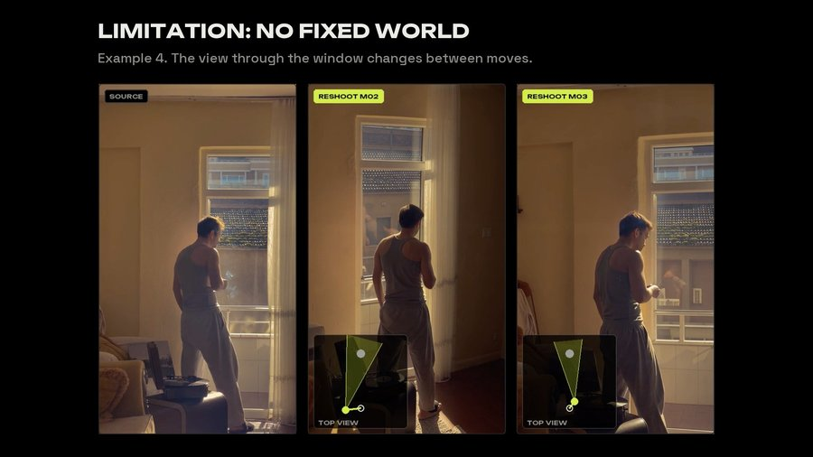

**Fast motion smears.** Quick spins and fast arms can melt a face for a few frames. In Example 6 her face smears mid-spin.

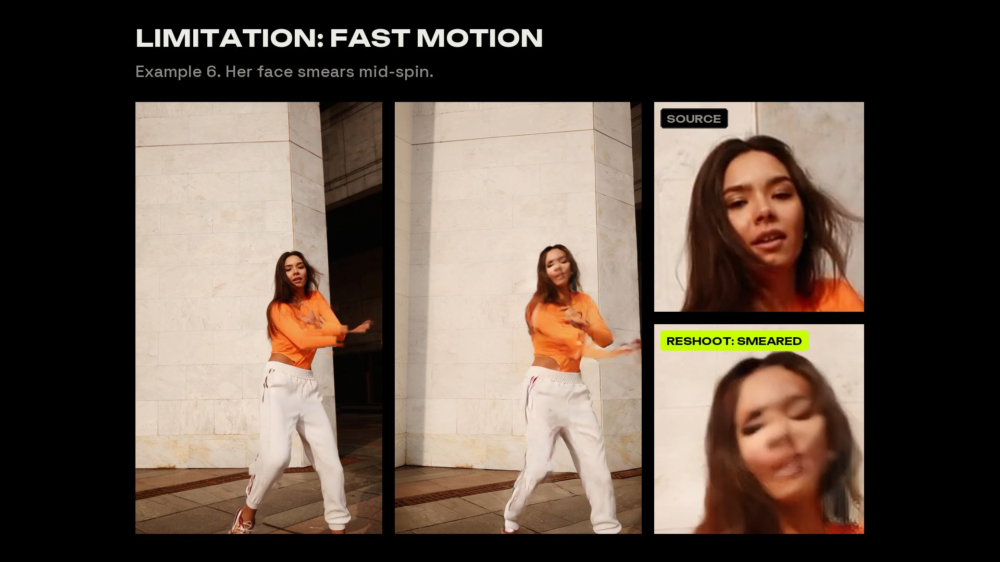

## Virtual Camera - 4D Camera Editor

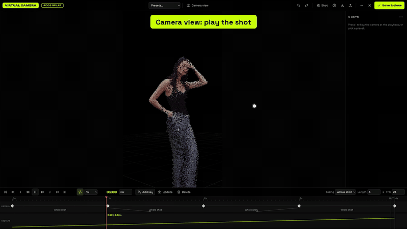

- **Camera keys.** Key the camera's position, aim and roll at any moment. Paths between keys run as smooth orbits or splines.
- **Camera view and editor view.** Look through the shot camera, or press C to step outside and see the capture, the path and every key.
- **Blender-style view gizmo.** Click a dot for top, front or side, or drag it to orbit around the 4D capture.
- **A timeline built for shots.** Play, shuttle with J / K / L, step frames and jump between keys. Shift-select keys to move, rotate or retime them together.
- **Presets.** Start from an arc, push, crane, orbit or bullet-time move, then edit the keys.
- **Portable camera paths.** Paths export relative to the source camera, so a move made on one capture replays on another.
- **Camera files.** Import a camera from `.fbx`, `.abc` or `.usd`: pick one if the file holds several, and the move starts on the source camera at approximate real scale (assuming a 1.7 m person), with its lens, roll, focus and aperture.
- **Camera settings per key.** Aperture, focus (a distance or the subject), vignette and grain on each key, for rack focus, aperture pulls and zooms. Camera FX applies them after the reshoot.
- **Focus in the viewport.** The camera view previews the keys' focus and aperture; Alt+click anything to focus the key on it.
- **Lens character.** Per shot: distortion, chromatic aberration, bloom, halation, anamorphic (oval) bokeh and a shutter angle for motion blur.
- **Camera export.** Save the move as an `.fbx`, `.usd` or `.abc` camera (with the real source camera and a subject marker) for Blender, Nuke or Unreal. Import a file with several cameras and each can be saved as its own path.

See the [Editor guide](docs/EDITOR.md).

## Install

Tested on Ubuntu 24.04 with one NVIDIA RTX 3090 (24 GB). A shot takes about 30 minutes from camera move to final video.

```bash
cd ComfyUI/custom_nodes
git clone https://github.com/itsmetamike/reshoot-4d.git
git clone https://github.com/cseti007/ComfyUI-CrossViewWarp.git && git -C ComfyUI-CrossViewWarp checkout 3266a83a84eaa6833a9ebc38ac7cdd8789e44f5b
bash reshoot-4d/scripts/install_redirector.sh
```

Then follow [Install](docs/INSTALL.md) for the Capture environments and models, restart ComfyUI and find the nodes under **Reshoot 4D**.

Optional: [Blender](https://www.blender.org/download/) to import `.fbx` / `.abc` / `.usd` cameras, and [ComfyUI-Frame-Interpolation](https://github.com/Fannovel16/ComfyUI-Frame-Interpolation) for Finish's frame rate. See [Install](docs/INSTALL.md#optional-camera-files-and-finishing).

## Docs

[Install](docs/INSTALL.md) · [Workflow](docs/WORKFLOW.md) · [Editor](docs/EDITOR.md) · [Retake setup](docs/REDIRECTOR.md) · [Path format](docs/PATH_FORMAT.md) · [Architecture](docs/ARCHITECTURE.md) · [Troubleshooting](docs/TROUBLESHOOTING.md) · [Models and licences](docs/MODELS_AND_LICENSES.md) · [Credits](docs/CREDITS.md)

## Licence

Copyright (C) 2026 itsmetamike. Code under [AGPL-3.0](LICENSE). Models keep their own licences, listed in [Models and licences](docs/MODELS_AND_LICENSES.md). Built with assistance from Claude Code and Codex.

A brutus labs project by [itsmetamike](https://github.com/itsmetamike), made locally on brutus.
