# Reshoot 4D

**Reshoot any video in 4D.**

- **Runs locally on open weights.** No API keys, no cloud services, no partner nodes.
- **Every step is a ComfyUI node.** The 4D camera editor is the Virtual Camera node's own panel.
- **LTX 2.3 renders every final frame.**

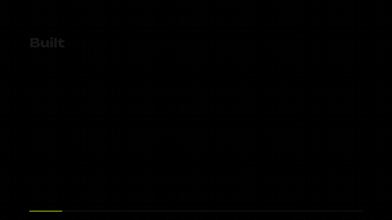

Watch the [explainer](site/media/explainer.mp4) (35 s) and the [walkthrough](site/media/walkthrough.mp4) (71 s).

## Node pack

| Node | What it does |
| --- | --- |
| **Capture** | Turns a video of a person into a 4D capture of them in their setting and solves the real source camera. |
| **Virtual Camera** | Opens the 4D camera editor on the node. Keyframe a new camera over the moving capture; the path saves with the workflow. |
| **Retake** | Reshoots the whole source video along your path (ReDirector). |
| **Photoreal Pass** | LTX 2.3 renders the final frames from the retake, guided by the real video and a depth warp of it along your path (CrossView-Warp IC-LoRA). |

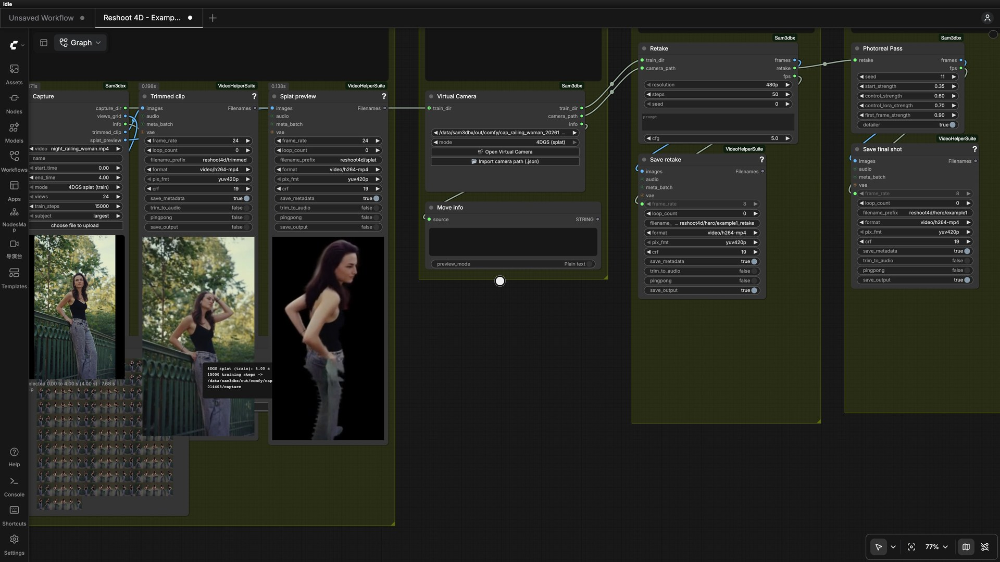

Load [the Reshoot 4D workflow](workflows/Reshoot%204D.json) and follow the [Workflow guide](docs/WORKFLOW.md).

## Results

Each example: the source video, then three new camera moves. The top view on each reshoot shows the camera path.

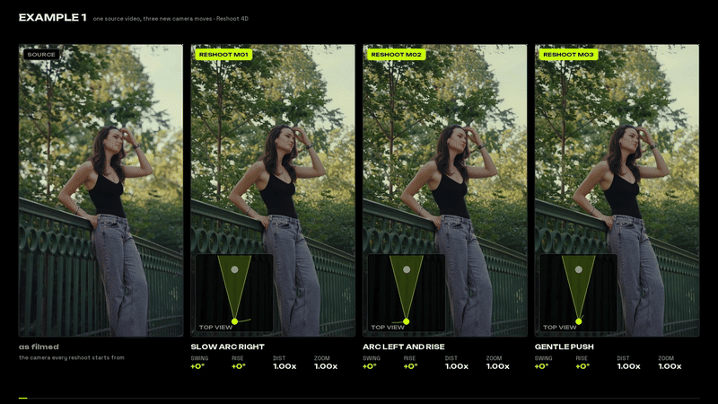

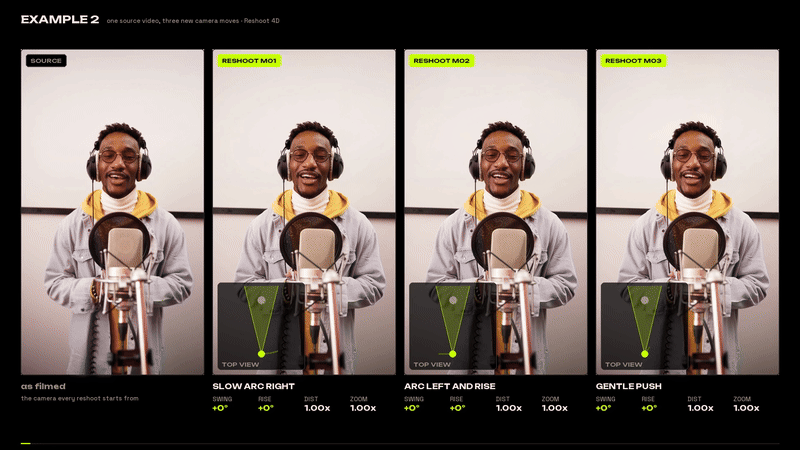

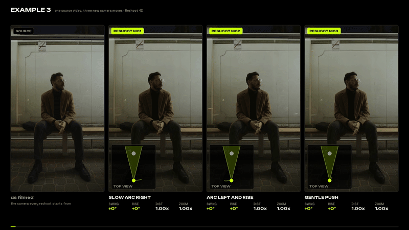

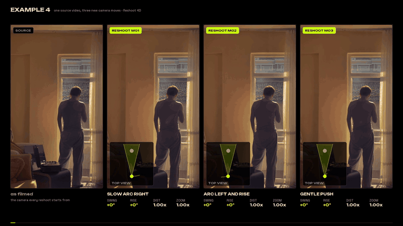

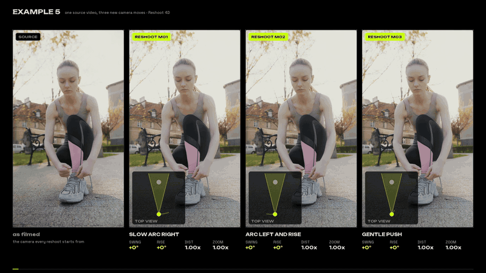

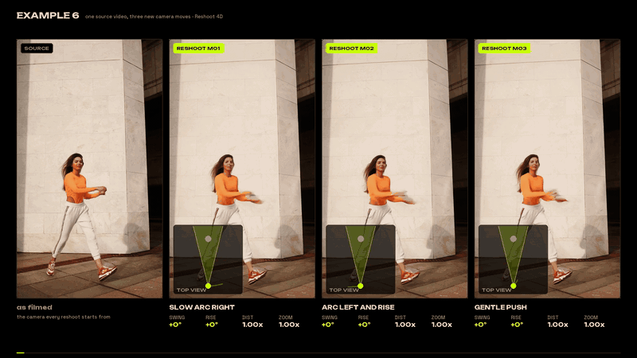

Footage from Pexels, see [Credits](docs/CREDITS.md).

## Limitations

**No fixed world.** Reshoot 4D does not build a 3D world and composite the person onto it. Each reshoot regenerates what the source camera never saw, so off-camera objects can differ from one angle to the next. In Example 4 the view through the window changes between moves.

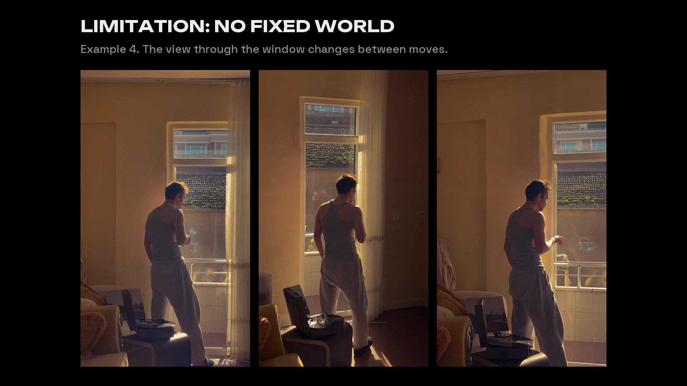

**Fast motion smears.** Quick spins and fast arms can melt a face for a few frames. In Example 6 her face smears mid-spin.

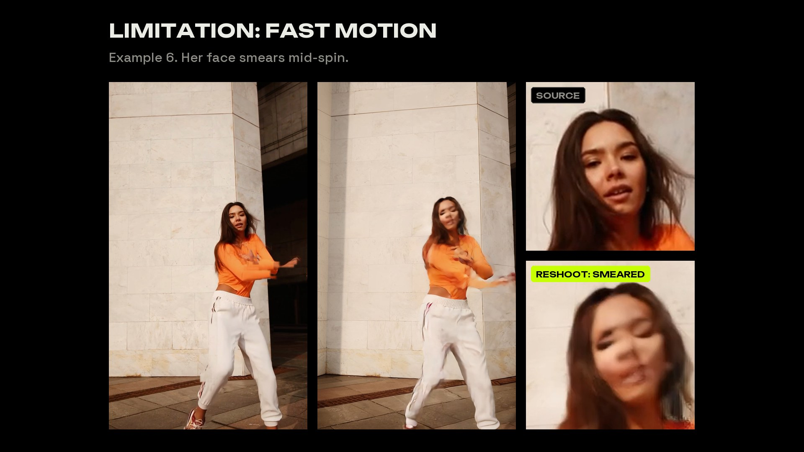

## Virtual Camera - 4D Camera Editor

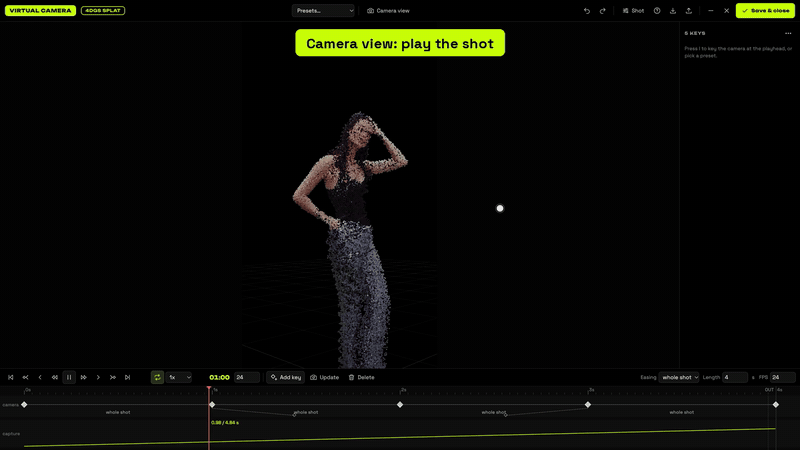

- **Camera keys.** Key the camera's position, aim and roll at any moment. Paths between keys run as smooth orbits or splines.
- **Camera view and editor view.** Look through the shot camera, or press C to step outside and see the capture, the path and every key.
- **Blender-style view gizmo.** Click a dot for top, front or side, or drag it to orbit around the 4D capture.
- **A timeline built for shots.** Play, shuttle with J / K / L, step frames and jump between keys. Shift-select keys to move, rotate or retime them together.
- **Presets.** Start from an arc, push, crane, orbit or bullet-time move, then edit the keys.
- **Portable camera paths.** Paths export relative to the source camera, so a move made on one capture replays on another.

See the [Editor guide](docs/EDITOR.md).

## Install

Tested on Ubuntu 24.04 with one NVIDIA RTX 3090 (24 GB). A shot takes about 30 minutes from camera move to final video.

```bash
cd ComfyUI/custom_nodes
git clone https://github.com/itsmetamike/reshoot-4d.git
git clone https://github.com/cseti007/ComfyUI-CrossViewWarp.git && git -C ComfyUI-CrossViewWarp checkout 3266a83a84eaa6833a9ebc38ac7cdd8789e44f5b
bash reshoot-4d/scripts/install_redirector.sh
```

Then follow [Install](docs/INSTALL.md) for the Capture environments and models, restart ComfyUI and find the nodes under **Reshoot 4D**.

## Docs

[Install](docs/INSTALL.md) · [Workflow](docs/WORKFLOW.md) · [Editor](docs/EDITOR.md) · [Retake setup](docs/REDIRECTOR.md) · [Path format](docs/PATH_FORMAT.md) · [Architecture](docs/ARCHITECTURE.md) · [Troubleshooting](docs/TROUBLESHOOTING.md) · [Models and licences](docs/MODELS_AND_LICENSES.md) · [Credits](docs/CREDITS.md)

## Licence

Copyright (C) 2026 itsmetamike. Code under [AGPL-3.0](LICENSE). Models keep their own licences, listed in [Models and licences](docs/MODELS_AND_LICENSES.md). Built with assistance from Claude Code and Codex.

A brutus labs project by [itsmetamike](https://github.com/itsmetamike), made locally on brutus.
