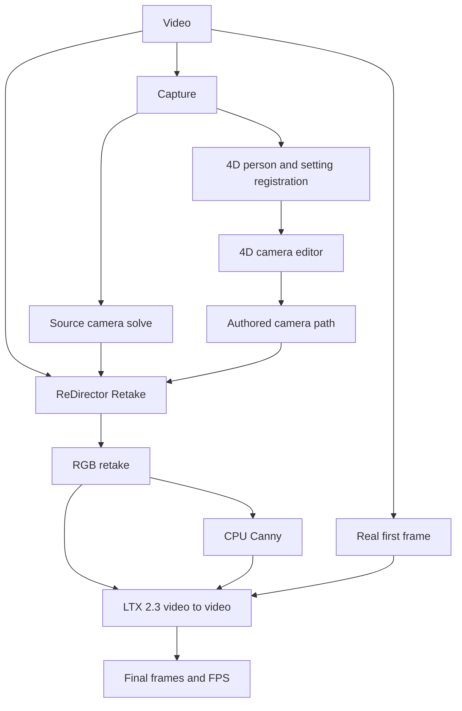

# Architecture

Reshoot 4D has a capture/editor branch and a final-video branch. They share the source footage, estimated cameras, body placement and authored camera path.

The 4D capture supplies the editor preview and a reusable asset. The final-video branch uses the RGB retake as input to LTX 2.3.

| Code | Responsibility |
| --- | --- |
| __init__.py | Node registration and Virtual Camera integration. |
| nodes_super.py | Capture orchestration and auxiliary capture/render nodes. |
| source_cam.py | PnP source-camera solve from body observations and geometry. |
| scene_layer.py | DA3 depth/poses and person/setting registration; uses MoGe helper. |
| web/director.js | Browser 4D camera editor, key/timeline controls, presets and portable path import/export. |
| director.py | Camera/time sampler twin for saved paths. |
| retake.py | ComfyUI node expansion, camera conversion, retake job metadata, CPU Canny preparation and LTX handoff. |
| redirector_worker.py | Separate-environment ReDirector inference using the source video and two camera paths. |
| ltx_graph.py | Local LTX graph builder; the retake spec uses source video, precomputed control and real start image. |
| config.py | Root paths, GPUs, CUDA architecture and ReDirector environment path. |
| patches/ | Optional upstream subject-selection and training override changes; retain upstream licence notices. |

## Process and data boundaries

Capture generation, splat training and ReDirector use separate environments because they need different torch/runtime combinations. ComfyUI unloads models before heavy subprocess work. GPU roles in config.py default to one device; a second device is optional, not pooled VRAM.

The Retake adapter reads capture metadata, writes path.npz and job.json in its capture output, then invokes the worker. It also prepares input videos and a real-first-frame guide in ComfyUI's input directory. The retake output socket carries the job JSON path to Photoreal Pass. Save generated frames through a video output node with the returned FPS.

Camera poses are estimates. The adapter uses uniformly selected source frames, fixed source intrinsics and an assumed body height for scale. See [Editor](EDITOR.md) for channel limits.

The selected expanded graph determines the model loaders and node providers required. Retake uses the local ltx_graph.py graph builder.
